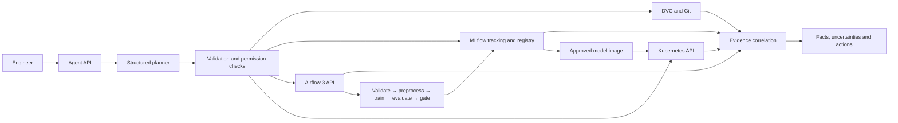

<p align="center"></p>

<p align="center">
  <a href="https://github.com/zohaib-umer/assignment-03-mlops-agent/actions/workflows/ci.yml"></a>
  
  
  
</p>

<p align="center"><strong>Trace a dataset. Compare experiments. Run a pipeline. Diagnose a deployment.</strong><br/>One operational interface, backed by recorded evidence.</p>

## Overview

OpsPilot connects DVC, MLflow, Apache Airflow and Kubernetes through a structured Python agent. It follows dataset provenance from a committed DVC reference to a trained model and its deployed application, returning facts, uncertainties, recommendations and the tool responses supporting them.

The reference workload classifies Iris flowers using a standardized logistic-regression pipeline. Training uses a fixed stratified split, records parameters and metrics in MLflow, and publishes a serving bundle only after passing its F1 quality gate.

| Capability | Implementation |
|---|---|
| Dataset provenance | DVC-tracked CSV, committed hashes, version comparison, remote reproduction |
| Experiment intelligence | MLflow run comparison, configurable metric ranking, artifacts and registry |
| Workflow operations | Authenticated Airflow 3 API, approved DAG triggers, failed tasks and logs |
| Deployment diagnosis | Pod readiness, restarts, events, logs, Services and deployed model identity |
| Multi-tool reasoning | Dependency-aware provenance lookup and evidence-based retraining assessment |
| Controlled operations | API authentication, exact confirmations, namespace restrictions and read-only RBAC |
| Verification | pytest, linting, pull-request CI and a separate live infrastructure workflow |

## Architecture



See [architecture.md](architecture.md) for design decisions and the complete tool/permission catalog.

## Installation

Prerequisites: Python 3.11, Git, Docker with Compose, `kubectl`, and a local Kubernetes cluster such as kind. Python 3.12 and 3.13 can run the agent; the container and CI reference environment uses 3.11.

```bash
git clone https://github.com/zohaib-umer/assignment-03-mlops-agent.git
cd assignment-03-mlops-agent
python -m venv .venv
source .venv/bin/activate
python -m pip install -e '.[dev]'
cp .env.example .env
```

On Windows PowerShell, activate with `.venv\Scripts\Activate.ps1` and use `Copy-Item .env.example .env`.

Set `AGENT_API_KEY` in `.env` to a long random value. Keep credentials in `.env` or environment variables; the repository ignores both local credentials and runtime artifacts.

### Environment configuration

| Variable | Purpose | Default |
|---|---|---|
| `MLFLOW_TRACKING_URI` | MLflow tracking endpoint | `http://localhost:5000` |
| `AIRFLOW_URL` | Airflow server base URL | `http://localhost:8080` |
| `AIRFLOW_USERNAME` / `AIRFLOW_PASSWORD` | Credentials exchanged for an API JWT | `admin` / configure locally |
| `AIRFLOW_TOKEN` | Existing JWT, used instead of password exchange | Empty |
| `APPROVED_DAG` | Training DAG permitted for execution | `training_pipeline` |
| `KUBE_NAMESPACE` | Namespace permitted for inspection and operations | `mlops` |
| `KUBE_DEPLOYMENT` | Deployment permitted for restart | `prediction-api` |
| `REPO_PATH` | Repository inspected by DVC tools | `.` |
| `AGENT_API_KEY` | Required `X-API-Key` credential | Configure locally |
| `OLLAMA_URL` | Optional local language-model endpoint | Empty |
| `LLM_MODEL` | Model used by the structured planner | `qwen2.5:7b` |
| `FRESHNESS_DAYS` | Maximum model age before recommending retraining; `0` disables | `30` |

## Launch the services

### 1. Restore the dataset

The dataset is deterministically reconstructed from scikit-learn's bundled Iris dataset. Its bytes must match the committed DVC pointer.

```bash
python -m training.train --prepare
dvc add data/iris.csv
git diff --exit-code data/iris.csv.dvc
```

For shared data storage, configure a DVC remote and upload the tracked CSV:

```bash
dvc remote add --local -d datasets /absolute/path/to/dvc-storage
dvc push data/iris.csv.dvc
```

Other checkouts with access to that remote can use `dvc pull`. The live verification workflow additionally restores the file in a separate Git worktree and compares its hash.

### 2. Start MLflow and Airflow

```bash
docker compose up -d --build
python scripts/wait_services.py
```

- MLflow: [localhost:5000](http://localhost:5000)
- Airflow: [localhost:8080](http://localhost:8080)

Airflow standalone generates its development login. Read it locally with `docker compose exec airflow cat /opt/airflow/passwords.json`, then set `AIRFLOW_PASSWORD` in `.env`. Enable `training_pipeline` in the Airflow UI before triggering it. The agent uses `/auth/token` and authenticated `/api/v2` requests.

On Linux, ensure the mounted repository permits the Airflow container user (UID 50000) to create `artifacts/`. The Compose stack uses local volumes for MLflow storage and Airflow state.

### 3. Train an approved serving model

```bash
python -m training.train
```

The command validates data, splits and scales it without test-set leakage, trains the classifier, records an MLflow run, and enforces macro F1 ≥ 0.90. Accepted models are registered as `iris-classifier` and exported under `artifacts/work/serving/`.

Use `dvc repro` to execute the same training stage through DVC. MLflow must be reachable at the configured tracking URI.

### 4. Deploy to Kubernetes

```bash
kind create cluster --name opspilot
docker build -t opspilot-inference:1.0.0 .
kind load docker-image opspilot-inference:1.0.0 --name opspilot
kubectl apply -f kubernetes/namespace.yaml
kubectl apply -f kubernetes/
python scripts/stamp_deployment.py
kubectl rollout status deployment/prediction-api -n mlops --timeout=180s
kubectl port-forward -n mlops service/prediction-api 8001:80
```

The Deployment requests two replicas, includes readiness and liveness probes, defines resource requests/limits, and loads non-sensitive settings from a ConfigMap. The model run and registry version are stamped into Pod-template annotations.

```bash
curl http://localhost:8001/health/ready
curl -X POST http://localhost:8001/predict \
  -H 'Content-Type: application/json' \
  -d '{"sepal_length":5.1,"sepal_width":3.5,"petal_length":1.4,"petal_width":0.2}'
```

### 5. Start the agent

```bash
uvicorn agent.main:app --host 127.0.0.1 --port 8000
```

Open [API documentation](http://localhost:8000/docs). Supply the configured API key in the `X-API-Key` header.

```bash
curl -X POST http://localhost:8000/chat \
  -H "X-API-Key: $AGENT_API_KEY" \
  -H 'Content-Type: application/json' \
  -d '{"message":"Find the best recent model, identify the dataset version used to train it, check the deployment status, and explain whether retraining is necessary."}'
```

The curl example expects `AGENT_API_KEY` in the shell environment. The application itself also reads `.env`.

## Agent interaction

| Request | Optional structured arguments |
|---|---|
| “Identify the current dataset version and reproduce it.” | `revision` |
| “Which dataset was used for experiment?” | `run_id` |
| “Find the best recent model based on F1.” | `metric`, `direction`, `limit`, `experiment_ids` |
| “Check training pipeline status.” | `dag_id` |
| “Why is my prediction API unavailable?” | `namespace` |
| “Find the best recent model, check deployment and explain whether retraining is necessary.” | `metric`, `limit` |

Every answer includes `facts`, `uncertainties`, `recommendations`, and `evidence`. A successful trigger means a run was requested; the agent checks workflow status separately before reporting completion.

State-changing requests require an exact confirmation tied to the operation and target:

```json
{
  "message": "Trigger the training pipeline",
  "arguments": {"dag_id": "training_pipeline"},
  "confirmation": "CONFIRM airflow.trigger training_pipeline"
}
```

For an authorized restart, use `CONFIRM kubernetes.restart mlops/prediction-api`. Kubernetes credentials must independently permit the operation. The supplied service account is read-only; the optional restart Role must be explicitly bound to an approved operator.

### Local language-model planning

Install [Ollama](https://ollama.com), run `ollama pull qwen2.5:7b`, then set `OLLAMA_URL=http://localhost:11434`. OpsPilot requests a JSON-schema-constrained tool plan. All selected tools still pass the same validation and permission checks. With no Ollama endpoint configured, the built-in planner handles the documented operational requests. The mandatory multi-tool scenario always uses an ordered plan that resolves provenance before inspection.

## Tests and verification

```bash
ruff check .
pytest -q
```

Ordinary CI mocks external services. It checks tool selection and execution, timeouts, service failures, invalid input, provenance, authentication, mutation permissions, deterministic training, quality gates and inference readiness.

Run **Actions → Live infrastructure verification → Run workflow** to start actual MLflow and Airflow services, train a model, deploy it to kind, execute five conversations, reproduce a DVC dataset and recover from two injected failures. Download the `live-infrastructure-evidence` artifact for recorded requests, responses and service state.

## Repository guide

```text
agent/          Planner, policies, schemas and four tool adapters
api/            FastAPI prediction service
training/       Reproducible training and quality gate
dags/           Five-stage Airflow training DAG
data/           DVC dataset pointer
kubernetes/     Deployment, Service, ConfigMap and RBAC
tests/          Automated reliability and safety tests
scripts/        Live verification and deployment helpers
evidence/       Exported verification records
assets/         Project logo
docs/           Technical report and demonstration guide
.github/        Pull-request CI and live integration workflow
```

## Documentation

- [System architecture and tool permissions](architecture.md)
- [Technical report](docs/technical-report.md)
- [Demonstration and engineering defense](docs/demo-guide.md)
- [Evidence index](evidence/README.md)

Built for **Assignment 03 — MLOps & Production AI Engineering, Fall 2026**.
