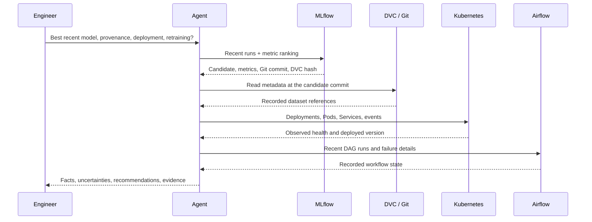

# System architecture

OpsPilot separates intent selection, authorization, service access and evidence interpretation. The engineer submits a natural-language request and typed arguments to FastAPI. The planner selects from an allowlisted registry; the executor validates inputs, applies confirmation rules, bounds waiting time and records structured metadata. Tool results form the only basis for operational facts.

## Components and data flow

1. **Agent API:** authenticates each operational request using `X-API-Key`; validates a Pydantic request schema and allocates a request identifier.
2. **Planner:** uses Ollama structured JSON for general read-only tool selection when configured, or the documented deterministic operation routes. Mutation routes require explicit imperative requests and exact target-specific confirmations.
3. **Executor:** invokes approved methods only. It never accepts arbitrary commands or arbitrary Kubernetes resources. Errors become typed evidence records rather than invented results.
4. **Adapters:** use fixed subprocess argument arrays for Git/DVC, `MlflowClient` for experiment intelligence, authenticated Airflow 3 REST endpoints, and the Kubernetes Python client.
5. **Evidence correlation:** follows the selected run's `git.commit` into committed DVC metadata and checks `dvc.md5`; compares deployment annotations with the selected run; inspects recent workflows and health.
6. **Training:** validates the tracked dataset, makes a stratified split, fits scaling on the training partition, records evaluation, then applies an explicit quality threshold before model registration.
7. **Serving:** loads an accepted model bundle once at startup. Liveness indicates a running process; readiness requires a loaded model with a passed quality gate. Version responses retain MLflow run identity.

## Tool definitions and permissions

All tools accept the `ToolArgs` schema. `/tools` exports the complete JSON schema and permission for every registered operation. Optional fields have defaults; method-specific identifiers are required by the corresponding adapter. Every output uses `ToolResult`, including status, data/error, duration and request ID.

| Tool | Relevant inputs | Output | Permission |
|---|---|---|---|
| `dvc.datasets` | — | Tracked metadata and pipeline outputs | Read |
| `dvc.version` | `revision` | Resolved commit and committed dataset references | Read |
| `dvc.compare` | `revision`, `other_revision` | DVC content/hash differences | Read |
| `dvc.status` | — | Workspace changes | Read |
| `dvc.reproduce` | `revision` | Separate-worktree reproduction commands | Read; no checkout executed |
| `mlflow.experiments` | `limit` | Experiment IDs/names | Read |
| `mlflow.runs` | `experiment_ids`, `limit` | Recent runs with metrics, parameters and tags | Read |
| `mlflow.details` | `run_id` | Run details and artifact paths | Read |
| `mlflow.best` | `metric`, `direction`, `limit`, `experiment_ids` | Candidate and comparison window | Read |
| `mlflow.compare` | `run_ids` | Recorded run comparison across experiments | Read |
| `mlflow.registry` | `model_name` | Registry versions and source runs | Read |
| `airflow.dags` | `limit` | DAG listing | Read |
| `airflow.runs` | `dag_id`, `limit` | Recent workflow status | Read |
| `airflow.trigger` | `dag_id` | Requested run ID and initial state | Exact confirmation + approved DAG |
| `airflow.tasks` | `dag_id`, `run_id` | Task instances and failed tasks | Read |
| `airflow.logs` | `dag_id`, `run_id`, `task_id`, `try_number` | Available execution logs | Read |
| `kubernetes.pods` | `namespace` | Readiness, phases, restarts and container state | Approved namespace, read |
| `kubernetes.deployments` | `namespace` | Desired/ready replicas, images, model annotations | Approved namespace, read |
| `kubernetes.services` | `namespace` | Service type, selectors and ports | Approved namespace, read |
| `kubernetes.events` | `namespace` | Recent reasons, messages and involved objects | Approved namespace, read |
| `kubernetes.logs` | `namespace`, `pod` | Bounded container logs | Approved namespace, read |
| `kubernetes.restart` | `namespace` | Requested rollout of configured deployment | Exact confirmation + namespace + Kubernetes RBAC |

## Safety and reliability

- DVC commands use `shell=False`, fixed executables/operations and validated revisions resolved to commit hashes.
- Training verifies dataset bytes against the DVC pointer stored in the recorded commit. An uncommitted data change cannot receive misleading provenance.
- The executor never delegates permission decisions to the language model. Tool output is data, not instructions.
- Airflow authentication uses JWTs, not scraped pages. Only the configured DAG may be triggered.
- Kubernetes state changes require both application confirmation and cluster permissions. The default RoleBinding grants inspection only.
- Logs record tool name, status, duration and request ID, without arguments, credentials or raw error bodies. Returned service evidence is redacted.
- Tool timeouts preserve an unknown outcome. A timeout is never described as a successful operation. Inspect a timed-out write before retrying.
- Workflow retries are capped at two; all task dependencies use success semantics. Validation or gate failures block release output.
- A high F1 score selects a candidate; it does not establish production readiness. Retraining recommendations use configured freshness, a failed gate, or recorded degradation evidence.

## Deployment boundaries

The agent is launched on the operator's machine and uses its restricted Kubernetes context. The prediction service runs in Kubernetes. Airflow and MLflow run in Compose for the reproducible demonstration. The training image is promoted manually after its gate; neither assessment nor model ranking automatically changes a deployment.

Reference interfaces: [Airflow 3 public API](https://airflow.apache.org/docs/apache-airflow/3.0.3/security/api.html), [Airflow TaskFlow](https://airflow.apache.org/docs/apache-airflow/3.0.3/core-concepts/taskflow.html), [MLflow client](https://mlflow.org/docs/latest/api_reference/python_api/mlflow.client.html), and [DVC diff](https://dvc.org/doc/command-reference/diff).
